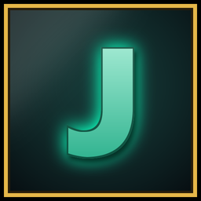

# JaseTools

*Formerly JaseQoL. The addon folder, saved settings and this repo keep the JaseQoL name, so updating loses nothing.*

Small quality-of-life tweaks for **WoW Forever**, each with its own on/off switch.

| Tweak | What it does | Needs |
|---|---|---|
| **XP Level Colour** | Colours unit frame and nameplate level text by whether the mob gives XP: red, orange, yellow, green, grey (grey = no XP), using the classic grey-level formula. | EllesmereUI ("Level Text: Difficulty Color" on) |
| **Experience in chat** | A chat line for every XP gain: the mob or quest, and how much was normal, rested bonus (blue) and XP buffs like Well Fed or Well-Rested (green, worked out from their percentages). | |
| **Dungeon Journal Skin** | Skins the Dungeon Journal window in the EllesmereUI style through EllesmereUI's skinning API. | EllesmereUI Blizzard Skins+, Dungeon Journal |
| **Dungeon Journal: new view** | `/jdj`: a cleaner, list-based Dungeon Journal: dungeon list with quest progress, bosses, a loot grid with filters (usable by me, hide owned), quests with status, live progress, quest chains, needed items, summon chains, Show on map / Show turn-in, Share and Track. The original window is one click away (Classic view). | Dungeon Journal |
| **Alt tracking** | Remembers each character's professions and what's in their bags, bank and mailbox (bank and mail are read when you open them). Characters show as first name + last initial. | |
| **Alt counts on item tooltips** | Item tooltips list which of your characters on this realm have the item: bags, bank, mail and total. | Alt tracking |
| **Alt inventory window** | `/jinv`: every item on all your characters on this realm, with search and per-character / bags / bank / mail filters. | Alt tracking |
| **Send mats to bank alts** | `/jmats`: assign materials to professions (or "Bank"); alts get the categories of the professions they have, and you can switch any on or off per alt. At the mailbox, pick an alt and press **Send mats**: every unbound stack for them is mailed (to their full name), 12 per mail. Each profession can also **send all BoE gear** (on for Enchanting by default). | Alt tracking |
| **Request mats from alts** | In your profession window, request a recipe's missing reagents from your alts. JaseTools plans who sends what (fewest logins, alts parked in bank towns, bags before bank) and each alt gets a job in the **Requests** tab with **Pull from bank** and **Send** buttons (exact amounts).  **Waylaid crates** in your bags show up in the Requests tab too: which bundle you can fill, from whom, and a Request button.| Alt tracking |
| **Resizable profession window** | Drag the grip in the profession window's bottom-right corner to make it bigger; the size sticks. Right-click the grip to reset. | |
| **Warn when selling BoE items** | Selling a Bind on Equip item to a vendor shows a big warning so you can buy it back. For a BoE label on bag slots, use EllesmereUI > Bags > Show BoE / Warbound Text. | |
| **Flag items your quests need** | Items a quest in your log asks for (like Scorpok Pincer) get a yellow "QST" tag on their bag slot, a "Needed for" tooltip line, and a warning if you sell one. | |
| **Quests category in EllesmereUI bags** | A Quests category in the All Items view with every quest item, including items a quest in your log needs. Your own item assignments still win. | EllesmereUI Bags |
| **Warn about copper in auction prices** | WoW Forever's auction house won't post single items (gear, recipes, scrolls) when the price has copper in it, and the sell window hangs. Posting one with copper warns you to relist at whole silver. Changes nothing. |  |
| **Auction house debug log** | Off by default. `/jahlog on` records every auction house call (and which addon made it), the server's replies, errors and blocked actions, and flags posts that get no reply. `/jahlog` shows the latest lines, `/jahlog mark <note>` adds a note. Saved at logout or `/reload`. | |
| **Don't auto-accept escort quests** | Accepting an escort starts it straight away. When EllesmereUI's Quest Tracker auto-accepts quests, escort quests are left open for you to accept when ready. Spotted by the game's Escort tag or the quest text. `/jq escort` marks the open quest as an escort, `/jq escort no` as not one, `/jq escort list` / `clear`. In a group it also tells everyone (whisper to each party member plus party chat; raid chat in a raid) not to auto-accept or auto hand it in (`escortAnnounce`, once per quest every 10 minutes). | EllesmereUI Quest Tracker auto-accept |
| **JaseTools button** | A J button you can drag anywhere: click for the JaseTools window (Inventory, Send mats, Requests, Settings tabs), right-click for Settings. Also in the minimap's addon menu. | |
| **Minimap button** | A round J button on the minimap's edge: click for the JaseTools window, right-click for settings, drag it round the minimap. | |
| **Mastercraft skin** | Skins Mastercraft in the EllesmereUI style (EUI window frames, neutral panels, your accent, your font) on top of Mastercraft's flat Classic look. Your previous Mastercraft look comes back if you switch it off. | EllesmereUI Blizzard Skins+, Mastercraft |
| **GuildOS skin** | Skins GuildOS in the EllesmereUI style: neutral dark windows, grey hairlines, your EUI accent instead of its gold, your EUI font. On GuildOS's flat "GuildOS" style. | EllesmereUI Blizzard Skins+, GuildOS |

## Switching tweaks on and off

- **JaseTools window → Settings tab** (`/jq`, or right-click the J button or the minimap button): every tweak with an On/Off switch and a tooltip. This is the only settings page; JaseTools adds nothing to EllesmereUI's options or the game's AddOns list.
- `/jq list` lists the tweaks, `/jq <key>` toggles one (`xpLevelColor`, `xpChat`, `xpBreakdown`, `xpMissedRested`, `xpMissedFood`, `djSkin`, `djOverhaul`, `altTracker`, `altTooltip`, `altInventory`, `bankMail`, `altRequest`, `profResize`, `boeGuard`, `questItemGuard`, `questBagCategory`, `ahCopperWarn`, `ahDebug`, `escortGuard`, `escortAnnounce`, `hubButton`, `minimapButton`, `mcSkin`, `gosSkin`)

Every dependency is optional: a tweak whose addon is missing simply does nothing.

## Install

In **WowUp** (WoW Forever selected): **Get Addons → Install from URL** → `https://github.com/Jaseoneoce/JaseTools`. WowUp then offers each new release as an update.

Or download `JaseQoL-vX.Y.Z-forever.zip` from the [releases](https://github.com/Jaseoneoce/JaseQoL/releases) and unzip it into `World of Warcraft\_forever_\Interface\AddOns\`.

What changed in each version: [CHANGELOG.md](CHANGELOG.md).

## Built with AI assistance

JaseTools is built with AI assistance: the code is written with [Claude Code](https://claude.com/claude-code) (Anthropic), and directed, reviewed and tested in game by Jase. Bugs are still ours, so please report anything that misbehaves.
